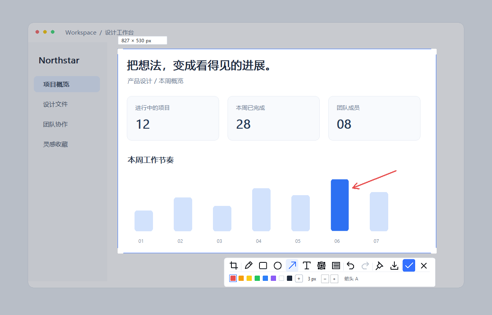
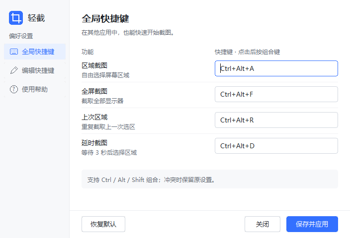
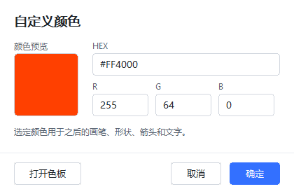
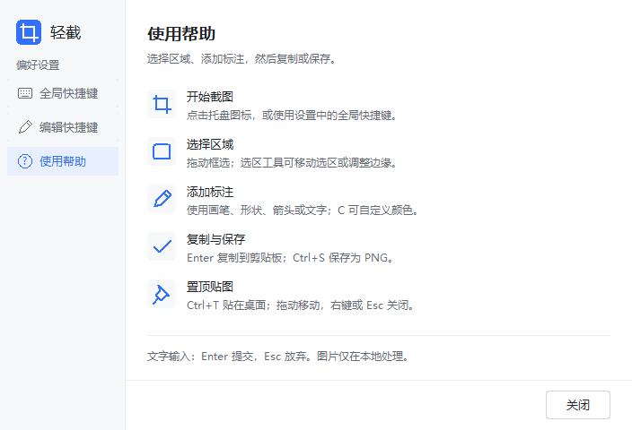

<div align="center">

# 轻截 Qingjie

**把截图这件小事，做得轻一点、顺手一点。**

一个用 Rust 编写的 Windows 原生截图工具。253 KiB，一个 exe，打开就用。


[下载最新版](https://github.com/puppet4/qingjie/releases/latest) · [使用指南](docs/usage.md) · [反馈问题](https://github.com/puppet4/qingjie/issues)

</div>



> 按下快捷键，框住重点，画两笔，复制走人。截图工具，就该这么干脆。

## 小身材，也有一套拿得出手的工具

轻截是我做的一款本地截图工具：想要它足够小，也想让常用操作足够顺手。从选区、标注到复制和贴图，把每天会用到的功能放进一个轻巧的原生程序里。

| 亮点 | 用起来是什么感觉 |
| --- | --- |
| **253 KiB，开箱即用** | 一个 exe，无需安装，不必携带开发环境。放进常用工具目录，双击即可。 |
| **Rust + Windows 原生界面** | 不捆绑浏览器或 WebView。后台等待系统事件，截图时才读取画面。 |
| **截图留在本机** | 不用登录账号，不上传截图；编辑、复制、保存均在本地完成。 |
| **四种截图入口** | 区域、全部显示器、上次区域、延时 3 秒，各有自己的全局快捷键。 |
| **标注工具够顺手** | 画笔、矩形、椭圆、箭头、文字、马赛克、实色遮挡，支持撤销与重做。 |
| **颜色自己定** | 预设色、HEX、RGB 和系统调色板；线宽可在 1–12 px 间调整。 |
| **复制、保存、贴图** | 复制到剪贴板、保存无损 PNG，或把截图置顶当作参考。 |
| **紧凑、清楚的界面** | 统一的设置与帮助页面，原生字体按 DPI 绘制，快捷键冲突时保留原绑定。 |

*253 KiB 是当前 0.1.0 x64 发布文件的实际大小：259,072 字节；不同编译器构建的体积可能变化。*

## 30 秒上手

1. 在 [Releases](https://github.com/puppet4/qingjie/releases/latest) 下载 **qingjie.exe**。
2. 双击运行。轻截常驻系统托盘，点击托盘图标也能开始截图。
3. 按 **Ctrl + Alt + A**，拖动鼠标选取区域。
4. 用下方工具栏标注，按 **Enter** 复制，或按 **Ctrl + S** 保存 PNG。

按 **Esc** 或右键取消截图。右键托盘图标可打开设置、使用帮助或退出程序。更新时先从托盘退出旧程序，再替换 exe。

### 截图快捷键

| 功能 | 默认快捷键 |
| --- | --- |
| 区域截图 | `Ctrl + Alt + A` |
| 全屏截图（全部显示器） | `Ctrl + Alt + F` |
| 上次区域截图 | `Ctrl + Alt + R` |
| 延时 3 秒截图 | `Ctrl + Alt + D` |

上述快捷键均可修改：**右键托盘 → 快捷键设置 → 点击输入框 → 按下组合键 → 保存并应用**。支持 Ctrl / Alt / Shift 组合；当前不支持 Win 修饰键。设置会保存，下次启动继续使用。



### 编辑时，手也可以不离开键盘

| 操作 | 快捷键 |
| --- | --- |
| 选择 / 移动 / 调整选区 | `V` |
| 画笔 / 矩形 / 椭圆 / 箭头 | `P` / `R` / `O` / `A` |
| 文字 / 马赛克 / 实色遮挡 | `T` / `M` / `B` |
| 自定义颜色 / 预设色 | `C` / `1–8` |
| 调整线宽 | `+` / `-` |
| 微调选区 / 调整尺寸 | 方向键 / `Ctrl + 方向键`；加 `Shift` 加速 |
| 撤销 / 重做 | `Ctrl + Z` / `Ctrl + Y` |
| 复制 / 保存 / 置顶贴图 | `Enter` 或 `Ctrl + C` / `Ctrl + S` / `Ctrl + T` |
| 取消截图 | `Esc` 或鼠标右键 |

编辑快捷键目前为固定映射。输入文字时，`Enter` 提交文字，`Esc` 放弃本次输入。贴图可以拖动，右键或 `Esc` 关闭。上次区域在当前运行期间保留。

<details>
<summary><strong>再看看颜色设置和内置帮助</strong></summary>

输入 `#RRGGBB` 或 RGB 数值即可自定义颜色，也能打开系统调色板。当前颜色用于后续标注，重启后恢复默认；实色遮挡使用固定深色。



常用操作也写进了软件内，随时查看。



</details>

*上面的图片由应用的原生界面与渲染代码生成；截图编辑示例使用模拟桌面，不包含真实用户信息。*

## 轻巧，也要把细节做好

- **需要截图时再分配画面资源。** 编辑结束释放截图和编辑状态；置顶贴图只保留裁剪后的图像。
- **保存失败，不覆盖原图。** PNG 编码、刷新和写盘完成后再原子替换目标文件。
- **快捷键冲突，不丢原配置。** 新快捷键注册失败或配置保存失败时，保留原绑定。
- **清楚写出验证范围。** 本版本通过 30 项常规回归测试及 Clippy 检查，包含 PNG 像素一致性、故障写入、撤销、窗口关闭、布局和 GDI 资源释放；详细记录见 [验证说明](docs/verification.md)。

## 从源码构建

需要 Windows、Rust stable（1.88+）、Visual Studio C++ 构建工具及 Windows SDK。

```powershell
git clone https://github.com/puppet4/qingjie.git
cd qingjie
./build.ps1 build
./build.ps1 package
```

生成的便携程序位于 `dist/qingjie.exe`，同目录提供 SHA256 清单 `release.json`。

```powershell
./build.ps1 test
cargo clippy --all-targets -- -D warnings
```

系统全局快捷键测试需要交互式 Windows 桌面。受限环境下可执行其余测试：

```powershell
cargo test -- --test-threads=1 --skip registration_swap_and_conflict_preserves_old_bindings
```

代码结构、配置文件位置和更详细的行为说明见 [完整使用指南](docs/usage.md)。

## 当前边界

当前面向 **Windows 10/11 x64**。暂未实现 OCR、滚动长截图、窗口吸附、截图历史、贴图缩放、开机启动及编辑快捷键自定义。混合 DPI 多屏拖动尚未完成全面实机验证；HDR、安全桌面与受保护视频可能无法正确采集。

敏感信息建议使用**实色遮挡**。遇到问题欢迎 [提 Issue](https://github.com/puppet4/qingjie/issues)，附上系统版本、显示缩放和复现步骤。

---

如果轻截让你的截图过程顺手了一点，欢迎点个 **Star** ⭐

**小工具，认真做。轻截，轻轻一截。**
